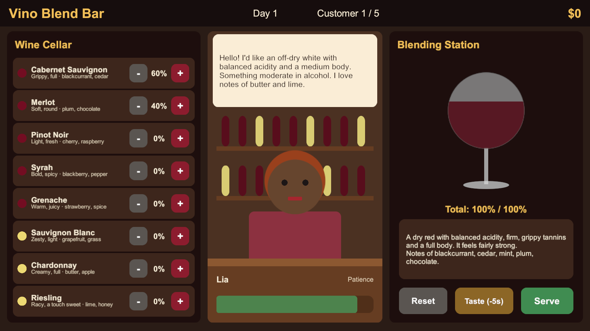

# בר הבלנדים (Vino Blend Bar)

**הלקוח מתאר את היין - אתם מנחשים את הענבים.**

## על המשחק

אתם עומדים מאחורי הדלפק של בר יין. לקוחות נכנסים ומתארים במילים איזה יין הם רוצים: יבש או מתוק, חומצי או רך, עם טאנינים חזקים או עדינים, ועם ניחוחות של דובדבן, וניל או פלפל שחור.

הם לא אומרים מאילו ענבים - את זה אתם צריכים לנחש. מרכיבים בלנד משמונה זנים (קברנה סוביניון, מרלו, פינו נואר, שיראז, גרנאש, סוביניון בלאן, שרדונה וריסלינג), טועמים, מתקנים ומגישים. אבל כל טעימה עולה ללקוח בסבלנות, ואם היא נגמרת הוא קם והולך.

אחרי כמה לקוחות כבר יודעים שסוביניון בלאן חומצי ורענן ושקברנה מביא טאנינים חזקים, בלי שהרגשתם שלמדתם.

## מסמך עיצוב

[הרכיבים הרשמיים של המשחק וסקירת משחקים קיימים](formal-elements.md)

## אב-טיפוס

בתיקייה [WineBlender](WineBlender) יש אב-טיפוס עובד ב-Unity 6 (גרסה 6000.3.25f1). כדי להריץ: פותחים את התיקייה ב-Unity Hub, פותחים את הסצנה `Assets/Scenes/SampleScene` ולוחצים Play.

## חברי הצוות

* דוד בלוך ([davidbloch18](https://github.com/davidbloch18))
* [להשלים: שם מלא] ([omrisabag2001](https://github.com/omrisabag2001))

