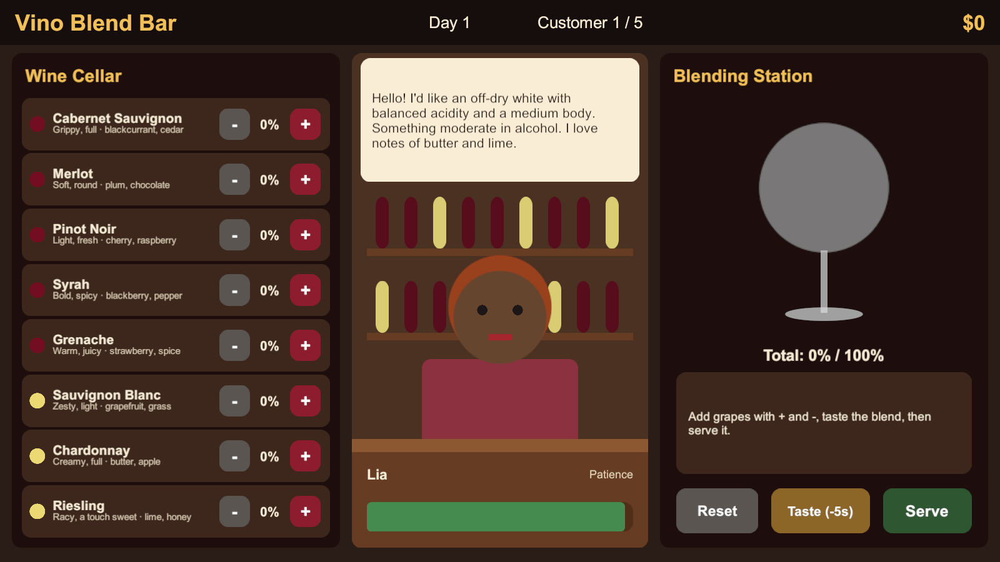
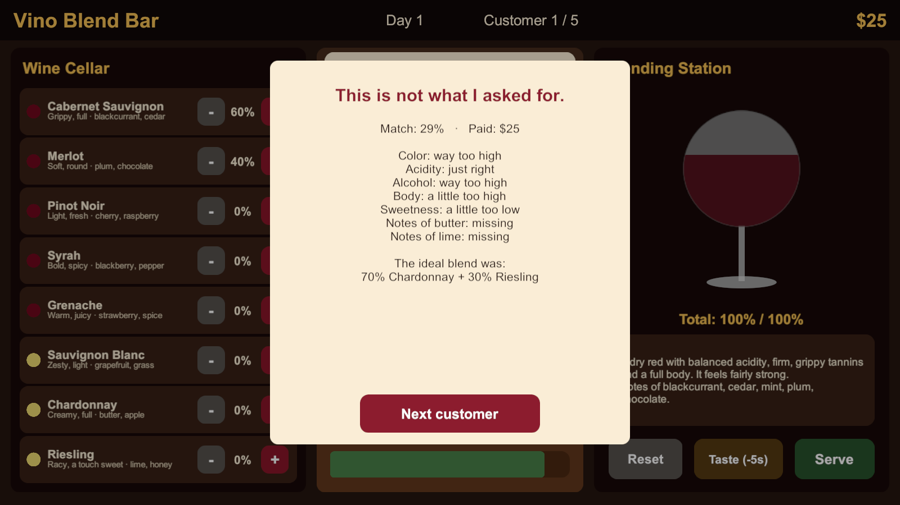

# בר הבלנדים (Vino Blend Bar)

**הלקוח מתאר את היין - אתם מנחשים את הענבים.**

## מהות המשחק

השחקן עומד מאחורי הדלפק של בר יין. לקוחות נכנסים ומתארים במילים איזה יין הם רוצים, למשל "יין אדום יבש עם חומציות מאוזנת, טאנינים חזקים וגוף מלא, עם ניחוחות של אוכמניות ופלפל שחור". הם לא אומרים מאילו ענבים, ואת זה השחקן צריך לנחש: הוא מרכיב בלנד משמונה זני ענבים באחוזים, ומגיש. ככל שהבלנד קרוב יותר למה שהלקוח ביקש, הוא מקבל יותר כסף וטיפ.

המשחק מיועד למחשב (Windows), ואפשר לבנות ממנו גם גרסה לדפדפן או לאנדרואיד. כבר יש לנו אב-טיפוס עובד ביוניטי.

---

## רכיבים רשמיים

### 1. שחקנים

* המשחק מיועד למבוגרים (18+, כי הוא עוסק ביין) - שחקנים קז'ואליים שאוהבים משחקי ניהול קצרים, חובבי יין, ומי שרוצה ללמוד על יין בלי לקרוא ספר. לא צריך שום ידע מוקדם על יין.
* שחקן אחד.
* בגרסה הבסיסית אין אינטראקציה בין שחקנים. בהמשך אפשר להוסיף טבלת שיאים (תחרותי) ואתגר יומי זהה לכולם.

### 2. יעדים

* בכל לקוח: להגיש בלנד שמתאים לבקשה כמה שיותר. בכל יום: לסיים את חמשת הלקוחות עם דירוג גבוה ועם רווח. לאורך המשחק: להגיע לדירוג של חמישה כוכבים ולהפוך ל"סומלייה ראשי".
* הלקוח מציג את היעד בבועת דיבור. בסוף כל הגשה מופיע אחוז התאמה, ובסוף כל יום מסך סיכום עם הדירוג והרווח.

### 3. תהליכים

התחלה (30 השניות הראשונות): הלקוח הראשון נכנס מיד ומזמין יין פשוט (בדרך כלל זן אחד או שניים). השחקן רואה את המרתף עם שמונת הזנים, ולכל זן תיאור קצר כמו "חומצי וקליל · אשכולית, דשא". הוא לוחץ על + ליד זן שנשמע מתאים, הכוס מתמלאת בצבע של היין, הוא מגיש ותוך שניות מקבל תוצאה ותשלום. כבר בחצי הדקה הראשונה הוא מבין את כל הלולאה ורוצה לנסות להשתפר בלקוח הבא.

ליבה (חוזר בכל לקוח):
1. לקרוא את הבקשה של הלקוח.
2. לבחור זנים ולשנות את האחוזים שלהם בכפתורי + ו- (בקפיצות של 10%).
3. לטעום (כפתור Taste) - המשחק מתאר את הבלנד באותן מילים שהלקוחות משתמשים בהן. כל טעימה עולה 5 שניות מהסבלנות של הלקוח.
4. לתקן את הבלנד לפי הטעימה.
5. להגיש (Serve) ולקבל ציון, הסבר מה היה גבוה או נמוך מדי, ואת הבלנד הנכון.

סיום: אחרי חמישה לקוחות היום נגמר ומופיע סיכום עם הרווח והדירוג הממוצע. היום הבא קשה יותר: בלנדים של עד שלושה זנים וסבלנות קצרה יותר.

פקדים: עכבר בלבד (או מגע בגרסת טלפון) - לחיצות על כפתורים.

איך לומדים: אין מדריך ארוך. התיאור הקצר ליד כל זן, הטעימה והמשוב אחרי כל הגשה מלמדים את השחקן תוך כדי משחק.

### 4. חוקים

* מגבילים את השחקן: הבלנד חייב להגיע בדיוק ל-100% כדי להגיש. אפשר לשנות אחוזים רק בקפיצות של 10%. לכל לקוח יש סבלנות מוגבלת, וכשהיא נגמרת הוא עוזב בלי לשלם.
* קובעים תוצאות:
  * כל תכונה של היין (חומציות, אלכוהול, טאנינים, גוף, מתיקות וצבע) היא ממוצע משוקלל של הזנים לפי האחוזים.
  * ניחוח של זן מורגש רק אם יש ממנו לפחות 20% בבלנד.
  * הציון משקלל את המרחק בין הבלנד לבקשה בכל תכונה (75%) ואת הניחוחות שהלקוח ביקש (25%).
  * התשלום תלוי בציון, וטיפ ניתן רק על הגשה מצוינת ומהירה.
* איך לומדים: המשוב אחרי כל הגשה אומר בדיוק מה היה לא בסדר, למשל "Acidity: a little too high", כך שהשחקן מבין את החוקים מהר.

### 5. משאבים

* המשאבים: הסבלנות של הלקוח (זמן), כסף, וטעימות (שעולות סבלנות). בגרסה המלאה יהיה גם מלאי ענבים שצריך לקנות.
* איך הם עוזרים: סבלנות נותנת זמן לחשוב ולטעום, וכסף יאפשר בגרסה המלאה לקנות זנים חדשים ולשדרג את הבר.
* איך משיגים: כסף מהגשות, טיפים על הגשות מצוינות.
* נדירות: כל טעימה "עולה" 5 שניות, כך שאי אפשר פשוט לנסות הכול. בכל יום הסבלנות של הלקוחות קצרה יותר.
* תצוגה: פס הסבלנות מתחת ללקוח (משנה צבע מירוק לאדום), הכסף בפינה העליונה, ומונה של לקוח מתוך חמישה.

### 6. עימותים

* מול המערכת: בקשות שמתוארות במילים כלליות, לקוח שהסבלנות שלו נגמרת, ובלנדים מורכבים יותר בכל יום.
* מול שחקנים אחרים: בגרסה הבסיסית אין. בהמשך - טבלת שיאים ואתגר יומי.
* מול עצמו (דילמות): לטעום עוד פעם כדי לדייק, או להגיש עכשיו ולקבל טיפ על מהירות? להוסיף זן כדי לקבל את הניחוח שהלקוח ביקש, גם אם הוא מקלקל את החומציות?

### 7. גבולות

* העולם סגור - מסך אחד של הבר: המרתף, הדלפק עם הלקוח ועמדת הבלנדים.
* העולם שטוח - מסך דו-ממדי אחד.
* הגבולות ברורים - הכול נמצא על המסך, ואין לאן "לצאת".
* עקרונות התכנון של המסך:
  * משמעות: לכל אזור תפקיד אחד ברור - המרתף לבחירת זנים, הלקוח לבקשה ולסבלנות, והעמדה לטעימה ולהגשה.
  * ניידות: כל הפעולות במרחק לחיצה, בלי מעברי מסכים.
  * התמצאות: הכוס מראה מיד את הצבע ואת הכמות, ו"Total" מראה כמה חסר ל-100%.
  * עניין: כל לקוח נראה אחרת ומבקש משהו אחר, והכוס משנה צבע תוך כדי ההרכבה.
  * הכוונה: סדר המסך משמאל לימין (מרתף, לקוח, עמדה) הוא גם סדר הפעולות, וכפתור Serve נדלק רק כשהבלנד מוכן.

### 8. תוצאות

* בכל לקוח: ציון של 0 עד 100% והתגובה של הלקוח ("Perfect!", "Lovely", "It's okay" או "Not what I asked for"), או שהלקוח עוזב אם נגמרה לו הסבלנות. בכל יום: דירוג של 0 עד 5 כוכבים ורווח.
* מזל מול כישרון: הבקשות אקראיות, אבל הציון תלוי לגמרי בכישרון של השחקן לפענח אותן. ככל שמשחקים יותר מבינים יותר את הזנים ומצליחים יותר.
* זה לא משחק סכום אפס - השחקן משחק נגד המערכת. עם טבלת שיאים הוא יהפוך לתחרותי בעקיפין.

---

## סקירת משחקים קיימים

ביטויי החיפוש שהשתמשנו בהם: "wine making blending simulator game steam", "From Soil to Bottle steam wine", "Coffee Talk steam brew drinks by customer description".

**1. Hundred Days - Winemaking Simulator**

[קישור לחנות Steam](https://store.steampowered.com/app/1042380/Hundred_Days__Winemaking_Simulator/)

סימולטור של יקב שלם: ניהול כרמים, תסיסה, יישון ומכירה.
מה אצלנו אחרת: Hundred Days עוסק בניהול עסק לאורך זמן, וההרכבה עצמה היא חלק קטן ממנו. אצלנו ההרכבה והפענוח של מה שהלקוח רוצה הם כל המשחק, וסבב שלם לוקח דקה.

**2. From Soil to Bottle**

[קישור לחנות Steam](https://store.steampowered.com/app/2873190/From_Soil_to_Bottle/)

סימולטור ארגז-חול של יקב, שבו אפשר לערבב זנים ולטפל בלקוחות תובעניים.
מה אצלנו אחרת: אצלם הלקוחות הם חלק מניהול העסק. אצלנו כל לקוח הוא חידה קצרה: הוא מתאר טעם במילים, והשחקן צריך "לתרגם" את המילים לענבים. זה משחק קז'ואלי ולימודי, לא סימולציה כבדה.

**3. Coffee Talk**

[קישור לחנות Steam](https://store.steampowered.com/app/914800/Coffee_Talk/)

משחק שבו מכינים משקאות חמים ללקוחות לפי מצב הרוח והאישיות שלהם, עם דגש על הסיפורים שלהם.
מה אצלנו אחרת: המבנה דומה - לקוח מבקש ואתה מכין - אבל אצלנו ההרכבה מבוססת על מאפיינים אמיתיים של זני יין, ולכן השחקן יוצא עם ידע אמיתי שאפשר להשתמש בו בחנות יין.

הרכיב שהכי מייחד את המשחק: החוקים. הבלנד מחושב לפי מאפיינים אמיתיים של כל זן (חומציות, אלכוהול, טאנינים, גוף, מתיקות וניחוחות), והבקשות מנוסחות במילים ולא במספרים - כך שהמשחק מלמד "לתרגם" טעם לענבים בלי שהשחקן ירגיש שהוא לומד.

